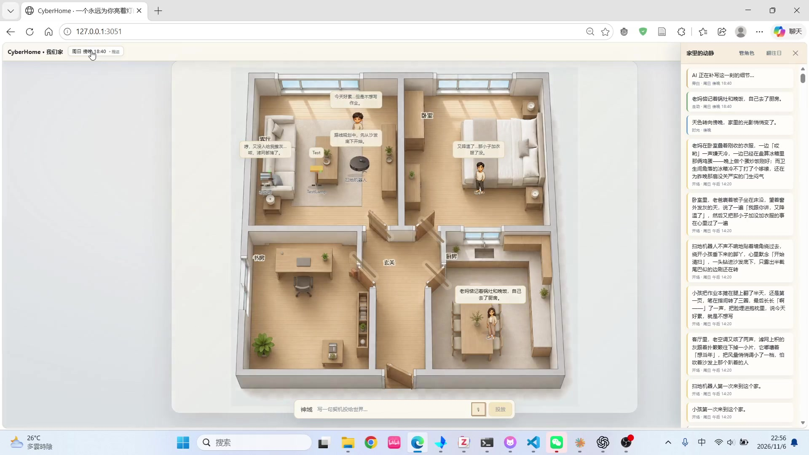

# zhengyifa · AI 应用与数据系统作品集

展示 CyberHome 与 TGAC Text-to-SQL Agent 的功能、架构和运行示例。

**[访问作品集](https://huber66.github.io/)** · **[CyberHome](https://huber66.github.io/projects/cyberhome.html)** · **[TGAC](https://huber66.github.io/projects/tgac.html)**

## 项目

| 项目 | 内容 | 入口 |
| --- | --- | --- |
| CyberHome | 家庭空间、角色对话、动态事件与长期记忆 | [详情](projects/cyberhome.html) · [源码](code/) |
| TGAC Text-to-SQL Agent | 2025 腾讯游戏算法大赛数智决策科学赛道冠军方案；业务逻辑注入、SQL 执行反馈与错误结果拦截 | [详情](projects/tgac.html) · [源码](https://github.com/Huber66/tgac-2025-text2sql-agent) |

## CyberHome：为什么做一个赛博家

**一个永远为你亮着灯的赛博之家。**

CyberHome 是我参与的小米黑客马拉松项目，也是一次把多 Agent 技术用于日常陪伴与空间创造的尝试。项目的出发点是一个很日常的愿望：下班回到住处，或者在深夜打开手机时，能走进一个熟悉、有生活气息的地方，看看在意的角色，知道他们刚刚经历了什么。

我们希望把“有人在”和“被记得”的感受，放进一个可以亲手创造的家庭世界。用户可以布置空间、设定角色的性格和习惯，让家人、室友，甚至一台爱抱怨的老空调住进同一个家。空间决定谁与谁相遇，人设与记忆参与角色的回应，日常事件则逐渐积累成这个家的共同经历。

因此，CyberHome 把**创造、观察、参与和记忆**连接起来：搭建时获得“这是我的家”的投入感；闲暇时看看角色之间发生了什么；想交流时与某个角色聊天，或向世界投下一件新鲜事；再次打开时，通过动态流接上之前的生活。我们希望用户愿意回来，是因为惦记这里的人和故事。

### 希望服务的使用场景

| 场景 | 希望带来的体验 |
| --- | --- |
| 喜欢创造和经营小世界 | 亲手布置空间、塑造角色，观察不同性格在同一房间里碰出怎样的互动 |
| 独居或需要碎片陪伴 | 工作间隙、下班后、深夜打开，进入一个有熟悉角色和日常故事的空间 |
| 想与家人共同创造 | 用熟悉的性格、口头禅和生活习惯设定虚拟角色，把一起搭家与观察故事变成共享话题 |

### 从产品想法到交互设计

核心体验是：**布置空间 → 创建角色 → 放入房间 → 观察互动 → 对话或投下事件 → 留下记忆与故事**。

| 交互与实现 | 为什么这样设计 |
| --- | --- |
| 家庭空间与角色摆放 | 让用户通过空间安排角色相遇，把布置家与故事发生联系起来 |
| 人物、家电与家具角色 | 用不同的人设和表达方式丰富家庭氛围，让生活里的物件也能参与故事 |
| 共处互动与自由对话 | 角色结合人设、所在房间、当前情境和记忆回应，让交流有具体的生活背景 |
| 神谕事件 | 用户写下“今天降温了”这类契机，让各角色按自己的性格反应，为世界引入新的变化 |
| 事件时间线与记忆 | 保存发生过的事，并在后续互动中检索相关经历，为持续相处提供上下文 |
| 开场故事与离线补演 | 首次进入时生成开场事件，再次打开时根据离开时长补演故事，兼顾生活连续感与推理开销 |

### 实际操作演示

约 1 分 54 秒，1080p。点击封面在作品集中播放，或[直接打开 MP4 视频](https://huber66.github.io/assets/demo/cyberhome-demo.mp4)。

[阅读 CyberHome 项目详情](https://huber66.github.io/projects/cyberhome.html) · [查看技术结构与本地运行说明](code/README.md)

## TGAC 运行示例

详情页介绍上下文构造、SQL 执行、结果拦截与最终重执行，并链接到公开演示的运行步骤和执行轨迹。

## 仓库结构

- `index.html`：按 CyberHome → TGAC 顺序展示的首页。
- `projects/cyberhome.html`、`projects/tgac.html`：项目详情页。
- `styles.css`、`portfolio.css`：共享样式与响应式布局。
- `assets/demo/`：演示视频与封面。
- `code/`：CyberHome 前后端源码展示版及运行说明。

录制于 2026-11-06。网页视频去除了开头约 2 秒的录制准备画面，原始录像保留在本地。
