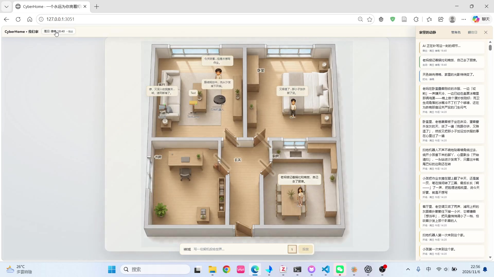

# CyberHome 源码展示版

CyberHome 是一个像素风的多 Agent 世界沙盒：用户可以搭建家庭空间、放置人物和家电，让角色在共同生活中自然产生关系和故事。

## 为什么做 CyberHome

项目希望把日常陪伴放进一个可以亲手创造的家：让喜欢创造的人有一个经营小世界的空间，让独居时的碎片时间里多一些熟悉的角色与生活气息，也让家庭成员能够围绕搭家、塑造角色和观察故事获得共同话题。

用户决定谁住在这里、角色是什么性格、彼此在哪个房间相遇；系统结合角色人设、当前情境与历史记忆生成回应，把对话和世界变化记入时间线。创造带来投入，相遇带来故事，记忆为下一次互动提供延续。

在这个过程中，空间、人设、时间和记忆共同服务于一个目标：让用户再次打开时，愿意看看这个家里又发生了什么。开场故事与离线补演为归家时刻提供内容，也让世界的连续感能够在有限的模型调用下呈现。

[阅读产品缘起与使用场景](../README.md#cyberhome为什么做一个赛博家) · [访问项目详情](https://huber66.github.io/projects/cyberhome.html)

## 操作演示

[](https://huber66.github.io/#demo)

[在作品集中观看演示](https://huber66.github.io/#demo) · [直接打开 MP4](https://huber66.github.io/assets/demo/cyberhome-demo.mp4)

## 项目说明

- **空间即舞台**：房间、人物和家电组成一个可以持续变化的家庭世界。
- **万物皆 Agent**：每个角色都有自己的名字、人设、状态、记忆和行为倾向。
- **共处产生故事**：角色在同一空间相遇后，根据当前情境和历史事件生成互动。
- **大模型驱动表达**：模型负责角色对话、开场故事、神谕反应和时间补演。
- **事件溯源与长期记忆**：世界变化会追加到事件时间线，角色可以沿着过去的经历继续生活。
- **可用性回退**：模型没有配置或暂时不可用时，系统仍可使用本地确定性回复完成基本闭环。

## 技术结构

- 前端：React、TypeScript、Vite
- 后端：Python、FastAPI、Uvicorn
- 模型层：OpenAI-compatible provider adapter
- 持久化：SQLite 事件日志与记忆接口
- 交互：REST API、Agent 对话、场景事件、流式响应

## 本地运行

```bash
# 后端
cd backend
python -m pip install -r requirements.txt
python -m cyberhome

# 前端（另开终端）
cd frontend
npm install
npm run dev
```

或者在项目根目录运行：

```bash
python server.py
```

## 配置说明

复制项目根目录的 `.env.example` 为 `.env`，再填入你自己的模型 Key。公开仓库不包含任何真实 API Key、数据库、运行日志或 `node_modules`。

## 目录内容

该目录包含 CyberHome 的主要前后端实现、测试和启动脚本。运行方式与模型配置见上文。
